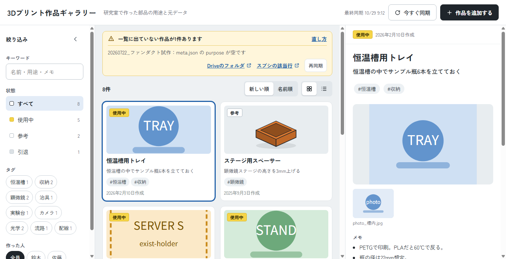

# 3Dプリント作品ギャラリー

研究室で3Dプリントした部品を、**Google ドライブに置くだけで一覧できるギャラリー**です。
「これ何に使うの？」「また刷りたい」「ちょっと寸法を変えたい」に、後から来た人が自分で答えられるようにします。



## できること

- **作品を一覧で見る**：写真・用途・状態（使用中／参考／引退）・タグで探せます。PC でもスマホでも使えます。
- **元データをそのまま取り出す**：作品ごとに、印刷用の STL / 3MF、Fusion の f3d、STEP をダウンロードできます。
- **ドライブにフォルダを置くだけで登録**：アップロード画面はありません。共有ドライブの `items/` に作品フォルダを置けば、次の同期で一覧に出ます。書き方が間違っていれば、画面の上に理由が出ます。
- **Fusion からまとめて書き出す**：Fusion のクラウドにあるデザインを、作品フォルダの形で一括して書き出すスクリプトが付いています。
- **AI エージェントに登録を手伝ってもらう**：説明文（meta.json）づくりとフォルダの整理を頼むための指示文を、画面からコピーできます。

## しくみ

```
共有ドライブ 3Dギャラリー/items/   ← 作品フォルダ（これが唯一の正）
   └ 20250612_流路セルホルダー/
        meta.json  thumb.png  holder.stl  holder.f3d  holder.step …
        │
        │ 同期（毎日自動 ＋ ボタンで今すぐ）
        ▼
スプレッドシート（一覧の写し） → ギャラリー（Google Apps Script の Web アプリ）
```

スプレッドシートとギャラリーは `items/` から作り直せる派生物です。壊れても、作品フォルダさえあれば元に戻せます。

必要なもの：Google Workspace のアカウントと共有ドライブ（大学・組織のアカウントを想定）。Fusion からの書き出しを使うなら Autodesk Fusion。サーバーや追加のサービスは要りません。

## セットアップ

所要時間は30〜60分ほどで、プログラミングの知識は要りません。手順の詳細は [tools/docs/SETUP.md](tools/docs/SETUP.md) にあります。

1. 共有ドライブに `3Dギャラリー/` を作り、中に `items/` と `tools/` を作る
2. このリポジトリの `tools/` の中身を `3Dギャラリー/tools/` に置き、`tools/items_template/_template/` フォルダを `items/` にアップロードする
3. スプレッドシートを新しく作り、「拡張機能 → Apps Script」を開く
4. `tools/gas/` の4ファイル（`Code.gs`・`index.html`・`guide.html`・`appsscript.json`）を貼り付ける
5. スクリプト プロパティ `ITEMS_FOLDER_ID` に、`items/` フォルダの ID を設定する
6. エディタで `setup` を実行して許可する（シートの準備と、毎日の自動同期の登録が行われます）
7. 「デプロイ → 新しいデプロイ」でウェブアプリとして公開する（実行ユーザー：アクセスしているユーザー）
8. 公開した URL を研究室のメンバーに伝える

## 使い方

- **作品を足す**：ギャラリー右上の「作品を追加する」に、手でやる方法と自動でやる方法が段ごとに並んでいます。基本はそれだけ読めば登録できます。
- **Fusion からまとめて書き出す**：[tools/docs/OPERATION.md の「Fusion書き出しの運用」](tools/docs/OPERATION.md#fusion書き出しの運用)
- **困ったとき・管理者の交代**：[tools/docs/OPERATION.md](tools/docs/OPERATION.md)

## 文書

| 文書 | 内容 |
| --- | --- |
| [tools/docs/README.md](tools/docs/README.md) | 使う人向けの案内（共有ドライブにも置く） |
| [tools/docs/SETUP.md](tools/docs/SETUP.md) | 構築手順 |
| [tools/docs/OPERATION.md](tools/docs/OPERATION.md) | 日々の運用、エラーの直し方、Fusion 書き出し |
| [tools/docs/DEVELOPMENT.md](tools/docs/DEVELOPMENT.md) | 改修する人向け：構成、データ仕様、テストの動かし方 |
| [tools/docs/AI_GUIDE.md](tools/docs/AI_GUIDE.md) | 改修を AI に頼むときの依頼文のひな形 |

`dev/` はテストとプレビュー（共有ドライブには置きません）、`docs/` は計画と開発の記録です。

## ライセンス

[MIT License](LICENSE)
